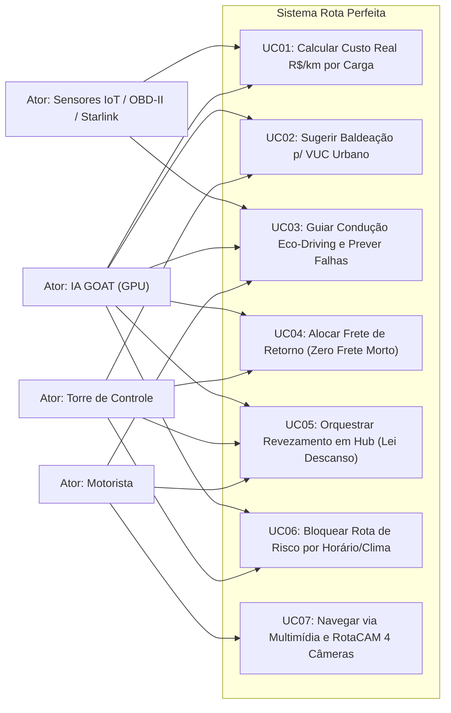
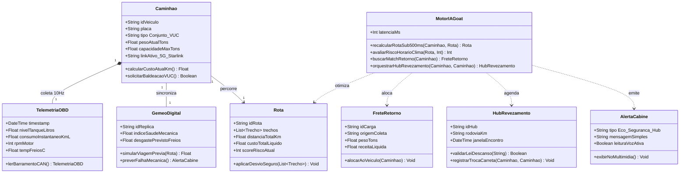
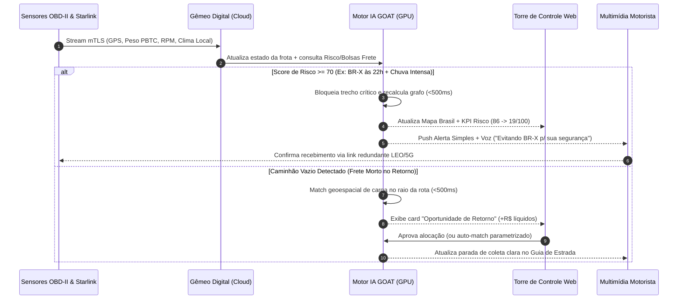

# Rota Perfeita — Arquitetura Enterprise, SRS & Protótipo

Documentação executiva e de engenharia do sistema **Rota Perfeita** (Torre de Controle Logística com IA Preditiva, Gêmeo Digital, Telemetria Satelital LEO e Multimídia de Cabine).

- **Aplicação Web Pronta (HTML + CSS + JS Externos):** [`index.html`](./index.html) · [`style.css`](./style.css) · [`script.js`](./script.js)
- **Proposta Comercial Detalhada (Teto `R$ 12M` · 650 Caminhões · Equipe Truck Tracker):** [`PROPOSTA_ORCAMENTARIA_12M.md`](./PROPOSTA_ORCAMENTARIA_12M.md)

---

## 1. Proposta Comercial e Justificativa Técnica (Equipe Truck Tracker)

### 1.1 Problema vs. Solução (Base: Modernização de 650 Caminhões Pesados)

| Dor Operacional | Solução Rota Perfeita (Truck Tracker) | Impacto / ROI Mensurável |
|---|---|---|
| Alto consumo de diesel e desgaste prematuro | Telemetria OBD-II/CAN J1939 + sensores capacitivos de tanque + Copiloto Eco-Driving IA GOAT | Economia conservadora de **-8,5% a -18,8%** em diesel (`R$ 1,18M/mês`) |
| Frete morto (retorno vazio ~38% das viagens) | Motor geoespacial de Match de Retorno em tempo real no corredor da rota | Alocação de retorno elevando margem líquida (`+R$ 585 mil/mês`) |
| Roubo de carga e sinistros climáticos | Bloqueio dinâmico de rodovias por mancha criminal horária + radar meteorológico + trava eletrônica | **-92% em sinistros** e queda em manutenção corretiva/seguro (`+R$ 347,5 mil/mês`) |
| Ociosidade por Lei do Descanso (Lei 13.103/2015) | Orquestração *drop-and-hook* em Hubs de revezamento (troca de carreta/motorista) | Ativo rodando **22h/dia** legalmente (+40% giro de frota) |
| Restrições urbanas de peso (ZMRC) e quebras | Sugestão automática de baldeação p/ VUC + Manutenção Preditiva via Gêmeo Digital | **-78% em panes na estrada** e -22% no custo de última milha |

- **Payback Estimado:** 5,6 meses | **ROI Líquido no Ano 1:** 114,1% (benefício operacional consolidado de `R$ 25,35 milhões/ano` na frota de 650 caminhões).

### 1.2 Stack Tecnológica Enterprise

- **IA Preditiva ("IA GOAT") & Roteirização:** Cluster Cloud GPU sob demanda + otimização VRP dinâmica (`< 500 ms`) + PyTorch / TensorRT + mensageria MQTT/Kafka.
- **Digital Twin (Gêmeo Digital):** Réplica 1:1 sincronizada por veículo (motor, freios, pneus TPMS, suspensão e consumo).
- **Telemetria IoT & Borda (Edge AI):** Gateway embarcado CAN-Bus SAE J1939 / OBD-II + sonda capacitiva de diesel + **RotaCAM** (MDVR SSD + 4 câmeras IP68 Full-HD IR com visão computacional ADAS/DMS).
- **Conectividade Híbrida Realista:** Dual-SIM 5G/4G Multi-Operadora + contingência satelital M2M nos **650 caminhões**, somada a **100 antenas satelitais LEO (Starlink Mobilidade)** dedicadas à subfrota de rotas críticas sem cobertura celular (Norte/Centro-Oeste).
- **Segurança & Cabine:** mTLS 1.3 + AES-256-GCM; Central Multimídia industrial 10" antirreflexo 24V (padrão CarPlay) com GPS offline e comando de voz.

### 1.3 Orçamento Consolidado — Ano 1 (Teto `R$ 12M` · 650 Caminhões Equipados)

| Bloco Orçamentário | Investimento (Ano 1) | % | Justificativa Técnica e Comercial |
|---|---:|---:|---|
| **A. Tecnologia Embarcada nos Caminhões (650 un.)** | `R$ 7.704.500,00` | 65,1% | Multimídia 10" CarPlay, gateway CAN/Edge AI, 4 câmeras RotaCAM SSD, sensores IoT, Dual-SIM 5G/Satélite M2M, 100 terminais LEO, instalação 24V e 20 kits reserva (`R$ 11.853,08`/caminhão). |
| **B. Infraestrutura Cloud, GPU & APIs (12m)** | `R$ 1.056.000,00` | 8,9% | Cluster Cloud/GPU elástico, licenças Google Maps Routes/Traffic API, radar climático/risco e mensageria IoT segura (`R$ 88.000,00`/mês). |
| **C. Equipe Truck Tracker (Aplicações, IA & SaaS)** | `R$ 3.078.000,00` | 26,0% | Desenvolvimento Torre Web, App CarPlay/CAN, IA Preditiva, rollout em pátio e licença SaaS + suporte 24x7 (`R$ 110`/cam/mês), gerando **`R$ 1.222.000,00` de lucro líquido** p/ a Truck Tracker no Ano 1 + ARR de `R$ 858 mil/ano`. |
| **Total Global Turnkey (Ano 1)** | **`R$ 11.838.500,00`** | **100%** | **Respeita o teto de `R$ 12.000.000,00` (folga de `R$ 161.500,00`) com foco em volume de caminhões.** |

### 1.4 Cronograma Macro de Execução (12 Sprints / 24 Semanas)

| Fase | Sprints | Entregáveis Principais | Marco |
|---|---|---|---|
| 1. Fundação & Telemetria Edge | Sprints 1–3 | Ingestão CAN/OBD-II + sensores de tanque, failover 5G/Starlink e segurança mTLS/TPM 2.0 | Telemetria Real-Time |
| 2. Gêmeo Digital & IA GOAT | Sprints 4–6 | Réplica Digital Twin da frota, modelos preditivos de falha/consumo e motor NVIDIA cuOpt (`<500 ms`) | Motor Preditivo Ativo |
| 3. Reversa, Hubs & Risco | Sprints 7–9 | Match de frete de retorno, orquestrador de revezamento/baldeação VUC e bloqueio dinâmico de risco | Torre de Controle Web |
| 4. Cabine UX & Rollout Nacional | Sprints 10–12 | Multimídia GPS + RotaCAM validado pelas Heurísticas de Nielsen, piloto em 50 carretas e escala p/ 650 caminhões | **Go-Live Nacional** |

---

## 2. Engenharia de Requisitos (SRS Enxuto)

### 2.1 Requisitos Funcionais (RF01 a RF08)

| ID | Módulo | Requisito Funcional |
|---|---|---|
| **RF01** | Telemetria e Consumo Real | Integrar sensores IoT no tanque e barramento OBD-II/CAN J1939 para calcular em tempo real o gasto exato em `R$/km`, ajustando a rota conforme peso atual (PBTC) e altimetria. |
| **RF02** | Telemetria e Consumo Real | Analisar cubagem, peso e restrições municipais (ex: ZMRC) para recomendar baldeação de carreta pesada para caminhões menores (VUC/Toco) em hubs urbanos. |
| **RF03** | IA "GOAT" Preditiva | Monitorar condução (RPM, frenagem brusca, inércia em rampa) via ML e orientar marcha/velocidade ideal na cabine em linguagem simples para economia de diesel. |
| **RF04** | Logística Reversa & Hubs | Identificar caminhões em retorno vazio (frete morto) e alocar cargas compatíveis em tempo real no corredor da rota, rateando o custo operacional. |
| **RF05** | Logística Reversa & Hubs | Calcular janelas e hubs estratégicos para troca de motoristas ou desengate rápido de semirreboques (*drop-and-hook*), operando 24h sem violar a Lei 13.103/2015. |
| **RF06** | Gestão de Risco Dinâmico | Cruzar manchas criminais por faixa horária, severidade climática e tráfego para bloquear rotas perigosas (ex: madrugada/tempestade) e desviar automaticamente. |
| **RF07** | IA "GOAT" Preditiva | Processar sinais térmicos/vibração do motor e freios junto às 4 câmeras **RotaCAM** para manutenção preditiva antes de pane na rodovia e eliminação de pontos cegos. |
| **RF08** | Multimídia do Motorista | Exibir guia visual de faixa estilo rodoviário e avisos sonoros/visuais não-técnicos na central multimídia, seguindo as Heurísticas de Usabilidade de Nielsen. |

### 2.2 Requisitos Não-Funcionais (RNF01 a RNF05)

| ID | Categoria | Especificação Mensurável |
|---|---|---|
| **RNF01** | Baixa Latência / Big Data | Recalcular milhões de variáveis (tráfego, clima, risco, PBTC e cargas de retorno) e atualizar a rota ativa em **`< 500 ms` (p99)** via cluster GPU. |
| **RNF02** | Conectividade Satélite & Offline | Operar em malha híbrida 5G Dual-SIM + Satélite LEO (Starlink) com buffer local Edge AI para **zero perda de pacotes** e navegação offline integral em áreas remotas. |
| **RNF03** | Gêmeo Digital (Digital Twin) | Manter réplica virtual 1:1 de cada caminhão na nuvem (sincronismo 10 Hz) para simular desgaste mecânico, consumo e baldeação antes e durante a viagem. |
| **RNF04** | Segurança Zero-Trust | Criptografar localização, telemetria e manifesto de carga ponta a ponta (`AES-256-GCM` + `mTLS 1.3` + `TPM 2.0`) com detecção de *jamming* e bloqueio autônomo via satélite. |
| **RNF05** | Usabilidade (Nielsen) | Interface de cabine sem jargão técnico, contraste `>= 7:1` (WCAG AAA), botões `>= 48px`, máximo de 1 alerta prioritário por vez, leitura por voz e confirmação em 1 toque. |

### 2.3 Fórmulas das Regras de Negócio

**1. Custo Total Líquido da Rota ($CT_{rota}$) e Custo Real por Quilômetro ($C_{km}$):**

$$CT_{rota} = \sum_{i=1}^{n} d_i \cdot \left[ \frac{P_{diesel}}{\eta_0} \cdot \left(1 + \alpha \cdot \frac{M_{carga,i}}{M_{max}} + \beta \cdot I_{relevo,i}\right) + C_{manut,i} \right] + C_{pedagio}(E) + C_{motorista}(t) + C_{baldeacao} - R_{retorno}$$

$$C_{km} = \frac{CT_{rota}}{\sum_{i=1}^{n} d_i}$$

**2. Score de Risco Dinâmico ($SR(t) \in [0, 100]$):**

$$SR(t) = \min\Big(100,\; 100 \cdot \big(0{,}35 \cdot I_{crim}(r,h) + 0{,}25 \cdot I_{clima}(r,t) + 0{,}20 \cdot V_{carga} + 0{,}10 \cdot F_{condutor}(t) + 0{,}10 \cdot S_{sombra}(r)\big)\Big)$$

- **Gatilho de Bloqueio Automático (`RF06`):** Se $SR(t) \ge 70$, o trecho $r$ recebe bloqueio imediato no grafo e a IA GOAT recalcula desvio seguro em `< 500 ms`.

---

## 3. Modelagem UML (Mermaid.js)

### 3.1 Diagrama de Casos de Uso

### 3.2 Diagrama de Classes

### 3.3 Diagrama de Sequência (Recálculo `<500 ms` por Risco ou Frete de Retorno)

